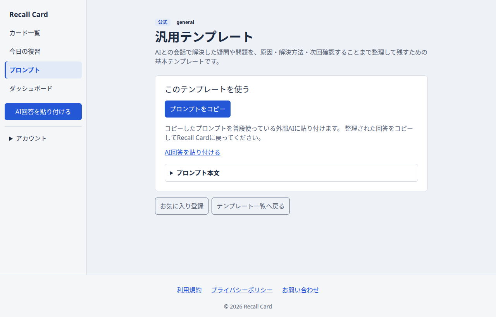
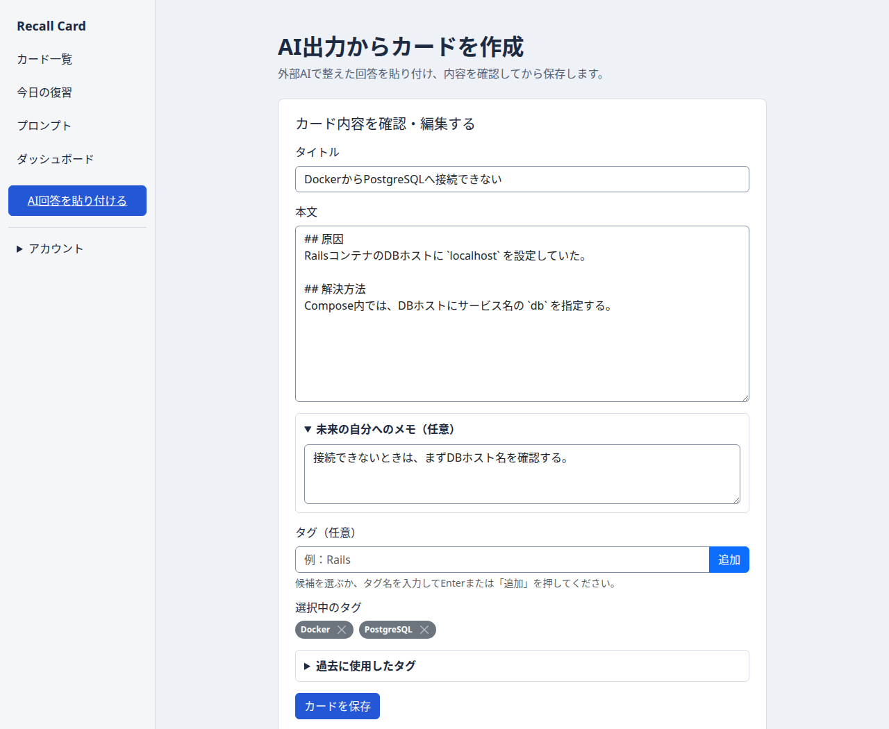
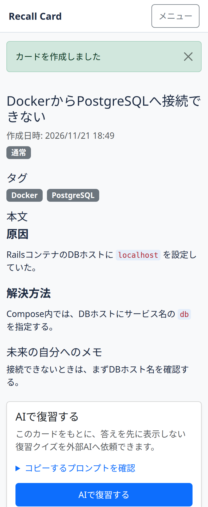
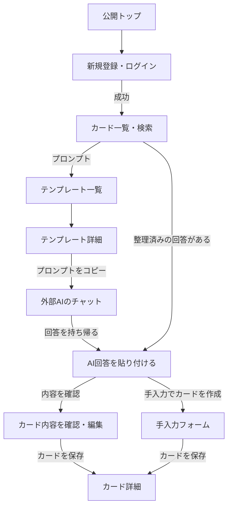
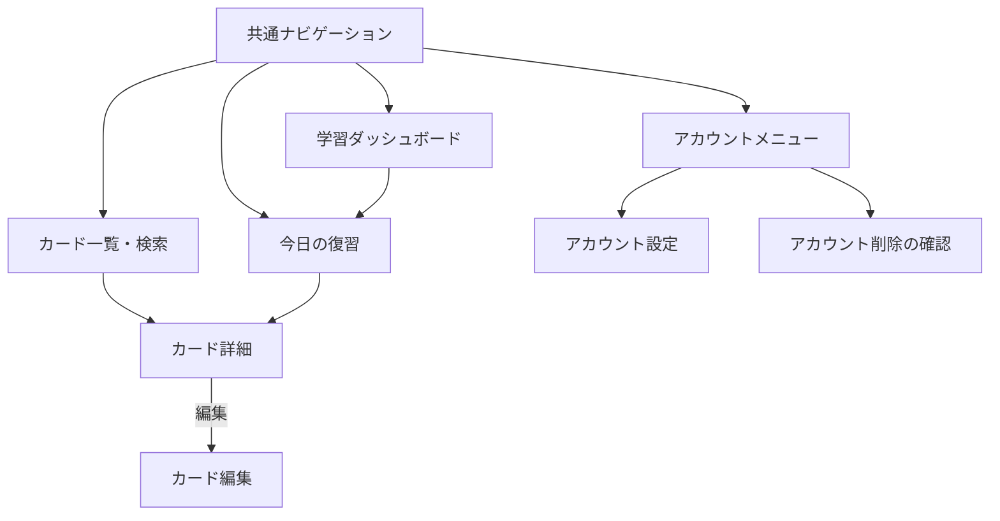
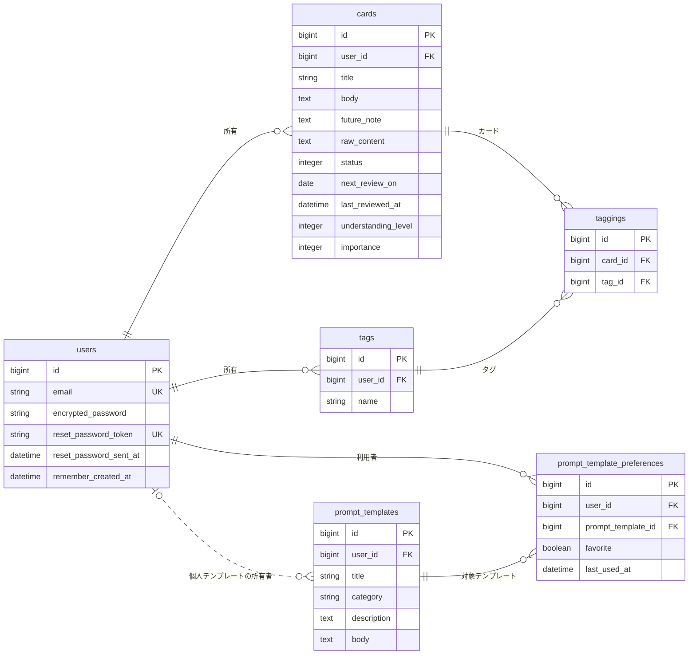

# Recall Card

## Re:solve - 未来の自分へ残す、つまずき解決カード

### 公開URL

https://recall-card.onrender.com/

---

## 1. サービス概要

Recall Cardは、AIとのチャット履歴や検索で解決した内容を、未来の自分が再利用できる「つまずき解決カード」として保存・検索・復習できるサービスです。

ChatGPT、Claude、Geminiなど、普段使っている外部AIで回答を整理し、Recall Cardに貼り付けます。内容を確認・編集してから、タイトル・本文・メモ・タグを持つカードとして保存できます。

NotionやObsidianのように綺麗に情報設計するのが苦手な人でも、雑に貼って、最低限残せることを大切にします。

### 外部AIの回答からカードを作る

1. ログインし、「プロンプト」から用途に合うテンプレートを開いて「プロンプトをコピー」を押します。
2. 解決内容がある外部AIのチャットにプロンプトを貼り付け、返ってきた整理済みの回答をコピーします。
3. Recall Cardの「AI回答を貼り付ける」を開き、「AIの出力」欄に回答を貼り付けて「内容を確認」を押します。
4. 解析されたタイトルと本文を確認・編集します。必要に応じて「未来の自分へのメモ」とタグを追加し、「カードを保存」を押します。
5. 保存後のカード詳細で内容を確認できます。後からカード一覧で検索したり、復習予定を設定したりできます。

整理済みの回答が手元にあれば、「AI回答を貼り付ける」から始められます。自分で書く場合は、同じ画面から「手入力でカードを作成」を選べます。

### スクリーンショット

架空の学習データで、テンプレート選択からカード保存までを撮影しました。

#### プロンプトのコピー



#### 貼り付けた回答の確認・編集



#### 保存後のカード詳細（スマートフォン幅）



### 画面遷移図

#### カード作成まで



「カード内容を確認・編集」では、貼り付けた回答を再解析できます。「プロンプトテンプレート一覧」から個人テンプレートを作成し、個人テンプレートの詳細から編集できます。

#### 保存後、復習、アカウント



- カードの編集を保存すると詳細に戻り、削除すると一覧に戻ります。詳細では復習日の設定・復習の記録、Markdownのダウンロード、外部AI向け復習クイズのプロンプトのコピーができます。
- ログアウト・退会後は公開トップに戻ります。ログイン画面からパスワード再設定を依頼でき、メールのリンクで新しいパスワードを設定します。利用規約・プライバシーポリシー・お問い合わせはフッターから開けます。

### ER図



- カードとタグの多対多の関係は `taggings` が管理します。公式テンプレートの `prompt_templates.user_id` は `NULL`、個人テンプレートには所有者のIDが入ります。
- タグ付けの `(card_id, tag_id)`、タグの `(user_id, name)`、テンプレート利用情報の `(user_id, prompt_template_id)` には複合一意制約があります。全テーブル共通の `created_at` と `updated_at` は図から省略しています。 [DBスキーマ](db/schema.rb)

---

## 2. このアイデアはどこから生まれたか

### 2-1. きっかけとなった体験・感情

学習する中で、生成AIや検索を使って問題を解決する機会が増えました。

その場ではエラーや疑問を解決できても、数日後に似た問題が起きたときに、「前回どうやって解決したか」「何が原因だったのか」「次は何から確認すればよいのか」を思い出せないことや、思い出すことが出来ても、手を動かすまでに至らないなどのケースがありました。

検索履歴やAIとのチャット履歴を探せばあるかもしれない。
Notionにまとめればいいのも分かっている。
Obsidianのようなツールで知識管理できれば理想的だとも思います。

しかし実際には、解決した直後は安心してしまい、整理を後回しにしがちです。
後でまとめようと思っても、チャット履歴は流れ、メモは散らかり、結局また同じことを検索したり、AIに聞き直してしまいます。

そのたびに、「解決できたはずなのに、自分の知識として残っていない」と感じました。

---

### 2-2. なぜそれが「気になった」のか

私は、AIを使って速く問題を解決すること自体は有効だと考えています。
一方で、AIに聞いて解決しただけで終わると、理解までのプロセスまで至らず、自分で説明できる知識にはなりにくいとも感じています。

特に自分は、綺麗に情報を整理したり、毎日丁寧に記録を続けたりすることが得意ではありません。
作業に入りさえすれば進められる一方で、前回どこまで理解したか、何に詰まっていたかを思い出すまでに時間がかかることがあります。

だからこそ、完璧な知識管理ツールではなく、ずぼらで面倒くさがりでも、最低限「未来の自分が助かる形」で残せる仕組みが必要だと感じました。

AIを使うことによって得た答えを、その場限りで消費するのではなく、自分の理解として回収する。
そのための軽い受け皿を作りたいと考えました。

---

## 3. 課題の整理

### 3-1. 表に見えている困りごと

- AIチャット履歴が増えて、後から探しにくい
- 同じようなエラーや疑問を検索したり、AIに聞き直してしまう
- NotionやObsidianで整理すればよいと分かっていても、運用が面倒で続かない
- 解決方法だけ残っていて、なぜ解決したのかが分からない
- AIの回答をその場で理解した気になるが、数日後には説明できない
- 解決した経験が、自分の知識として積み上がっている実感が薄い

---

### 3-2. 本当に解決したい課題は何か

#### なぜ、同じことをAIに聞き直してしまうのか

AIとのチャット履歴やメモが散らばっていて、前回の解決内容をすぐに見つけられないから。
前回の解決内容をしっかり理解していないから。

#### なぜ、前回の解決内容を見つけられないのか

解決直後に、タイトル・原因・解決策・次回確認することなどを、自分が後から使いやすい形で整理していないから。

#### なぜ、整理していないのか

まとめるのが面倒。何を書けば後から役に立つのか考えること自体が負担だから。

#### 本当に解決したい課題

AIや検索で一度解決した経験を、未来の自分が再利用できる形で残せず、同じつまずきに何度も時間と認知コストを使ってしまうこと。
過去と同じつまずきや応用的な問題に対し、対応出来る為の理解。

---

## 4. 想定ユーザーについて

### 4-1. 想定しているユーザー

#### 年齢設定

- 年齢：25〜35歳
- 理由：仕事をしながらスキルアップや業務改善に取り組み、時間が限られている中で学習を行う人。
  　　　　生成AIを日常、仕事でも使っている人が多いであろう年代であるため

#### 生活・状況設定

- 生活・状況：平日は仕事をしながら、夜や休日にスキルアップや、資格学習などをAIに聞きながら進めている会社員
- 理由：限られた時間で効率よく学習・作業する必要があり、AIで解決した内容を後から整理に時間をかけたくない。
  これを本アプリを使用してまとめることに時間をかけない。＋移動時間など隙間時間で見返せる形に変える。

#### 具体的な人物像

平日は仕事をしながら、夜や休日にWeb開発や業務改善を進めている28歳の会社員。
ChatGPTでエラーや疑問を解決することはできるが、後から履歴を探すのが面倒で、同じことを何度も聞き直してしまう。
NotionやObsidianで知識管理をしたい気持ちはあるが、ページ設計・タグ設計・テンプレート作成が面倒で続かない。

---

### 4-2. 自分とユーザーの距離

- 自分自身

このサービスは、自分自身の課題から生まれました。

私は、AIや検索を使って問題を解決する一方で、その解決経験を整理して残すことが苦手です。
「今は分かった」と思っても、数日後に同じことで詰まり、またAIに聞き直すことがあります。

自分自身が、完璧な知識管理ではなく、雑でもよいから未来の自分に引き継げる場所を必要としているため、この距離感にしました。

---

### 4-3. 実際に使われる可能性について

#### 最初に使ってくれそうな人

- RUNTEQなどでWeb開発を学んでいる人
- ChatGPTを使いながら個人開発を進めている人
- 業務でExcel、スプレッドシート、Webツール、AIツールを使っている会社員
- 資格学習や調べ物でAIを使っている人
- NotionやObsidianに興味はあるが、継続運用できていない人

#### その人は、どんな場面でこのアプリを思い出すか

- AIとのチャットで問題が解決した直後
- 「これはまた後で使いそう」と思ったとき
- 同じエラーや疑問を以前にも調べた気がしたとき
- ChatGPTの履歴を探すのが面倒だと感じたとき
- Notionにまとめるほどではないが、消したくない情報があるとき

#### 今の生活の中で、代わりに使っているもの

- ChatGPTのチャット履歴
- ClaudeやGeminiの履歴
- Notion
- Obsidian
- Notebook LM
- Google Keep
- メモアプリ
- ブラウザのブックマーク
- スクリーンショット
- SlackやDiscordの自分宛メモ

#### それを置き換えてまで使う理由はあるか

Recall Cardは、NotionやObsidianのような汎用知識管理ツールを完全に置き換えるものではありません。

むしろ、AIで解決した直後に、最低限の形で残すための入口として使います。

既存ツールは自由度が高い一方で、何をどの形式で残すかを自分で考える必要があります。
Recall Cardでは、AIチャット履歴をカード化するためのプロンプトテンプレートを用意し、ユーザーが整理方法を考えなくても、再利用しやすい形に整えられるようにします。

---

## 4-4. ユーザーがサービスを導入して利用するまでのイメージ

### どんな場面・困りごとがきっかけで、このサービスを知る・思い出すか

ユーザーは、AIとのチャットで疑問やエラーを解決した直後に、「この内容は後でまた使いそう」と感じます。

しかし、AIのチャット履歴だけに残しておくと、後から探すのが面倒になります。
NotionやObsidianに整理するほどの気力もないため、Recall Cardを使ってカードとして残します。

### 最初の一歩

解決したチャットを開いたまま、Recall Cardのテンプレートで会話の内容を整理します。画面上の操作は冒頭の手順に沿って進められます。 [外部AIの回答からカードを作る](#外部aiの回答からカードを作る)

### 利用を続ける理由

- AIで解決した内容を、チャット履歴に埋もれさせずに残せる
- タイトル・本文・タグで後から探しやすい
- 解決策だけでなく、原因や次回確認することまで残せる
- NotionやObsidianほど綺麗に整理しなくてもよい
- カードが増えるほど、未来の自分を助ける知識ベースになる

---

## 5. 既存サービス・競合調査

### 5-1. 似たサービスの調査

#### サービス名：NotebookLM

- URL：https://notebooklm.google.com/
- どんなことができるか：
  - 資料やWebページ、PDFなどのソースを読み込ませ、内容の要約、質問応答、学習ガイド作成などができる
  - 複数の資料を横断して理解する用途に向いている

#### サービス名：Notion

- URL：https://www.notion.so/
- どんなことができるか：
  - ドキュメント、データベース、タスク管理、Wikiなどを自由に作成できる
  - Notion AIを使って文章の要約、整理、生成もできる
  - 自分でテンプレートやデータベース設計を作れる人には強力

#### サービス名：Obsidian

- URL：https://obsidian.md/
- どんなことができるか：
  - Markdownを使ってローカルにノートを保存できる
  - ノート同士をリンクし、自分だけの知識体系を作れる
  - 長期的な知識管理や思考整理に向いている

---

### 5-2. それでも自分が作りたい理由

NotebookLM、Notion、Obsidianはどれも強力なツールです。

しかし、これらは自由度が高い分、ユーザー自身が情報の整理方法を考える必要があります。
「どこに保存するか」「どんなタイトルにするか」「どうタグ付けするか」「後で見返しやすい形式は何か」を自分で設計しなければなりません。

整理が得意な人にとっては自由度が強みになります。
一方で、整理が苦手な人や、面倒な運用が続かない人にとっては、その自由度が負担になります。

Recall Cardは、すべての情報を管理するサービスではありません。
AIとのチャット履歴や、AIで解決した内容を、未来の自分が再利用できるカードとして残すことに絞ります。
機能を絞ることで整理の手軽さや、簡単に操作できる感覚を生み出したいです。

NotionやObsidianの代替ではなく、それらを使いこなす前段階として、解決直後の内容を軽く残すためのサービスです。

---

### 5-3. 差別化を「体験価値」で表現する

このアプリは、AIで疑問を解決しても後から探せなくなる人が、解決直後の内容を未来の自分が使えるカードとして残せるようにするアプリです。

#### 私のアプリの差別化ポイント

NotionやObsidianのように整理方法を自分で設計しなくても、AIチャット履歴をカード化するためのプロンプトテンプレートを使い、タイトル・本文・タグつきの形で残せることです。

また、Recall Cardでは「カード」を以下のように定義します。

> AIで解決した1つの疑問・つまずき・学びを、未来の自分が再利用できる形で保存したもの。

カードには、最低限以下の情報を持たせます。

- タイトル
- 本文
- タグ
- 復習ステータス
- 未来の自分へのメモ

これにより、ただの保存ではなく、次回の自分を助ける引き継ぎとして使えるようにします。

---

## 6. このサービスで提供したい価値

### 6-1. ユーザーの変化

#### 行動の変化

- AIで解決した内容を、その場限りにせず保存するようになる
- カードを見返すことで、復習へのハードルが下げることが出来る。
- 解決直後に、未来の自分へ短い引き継ぎを残すようになる
- NotionやObsidianに綺麗にまとめる前段階として、気軽に記録できるようになる

#### 気持ちの変化

- 「また同じことを聞いている」という無力感が減る
- 自分の解決経験が積み上がっている感覚を得られる
- AIに頼っているだけではなく、自分の理解として回収している感覚を持てる
- 完璧に整理できなくても、最低限残せている安心感が生まれる

#### 考え方の変化

- AIとのやり取りは、一度きりの会話ではなく、未来の自分に渡せる材料だと考えられる
- 解決した直後こそ、知識として残すチャンスだと捉えられる
- 知識管理は完璧でなくてもよく、まずは雑でも残すことに価値があると考えられる

---

### 6-2. 価値を一文で表す

このサービスは、AIで解決した内容を後から探せず同じことを聞き直してしまう人が、雑にでも未来の自分を助けるつまずき解決カードを残せるようになるサービスです。

---

## 7. 現在の機能

| 機能 | できること |
| --- | --- |
| アカウント | メールアドレスで登録・ログイン・ログアウト、パスワード再設定、退会ができます。カードとタグはアカウントごとに管理します。 |
| プロンプトテンプレート | 汎用・学習や技術理解・雑メモ整理の公式テンプレートをコピーできます。個人テンプレートの作成・編集・削除、お気に入りと最近使ったテンプレートの確認もできます。 |
| カード | 外部AIの回答を貼り付けて解析する方法と、手入力で作成する方法があります。タイトル・本文を編集でき、メモとタグは任意です。詳細表示・編集・削除ができ、本文はMarkdownで表示します。 |
| 検索・絞り込み | タイトル・本文の部分一致検索、タイトル候補、タグ・復習状況での絞り込み、新着順・古い順の並べ替えが使えます。 |
| 復習・再利用 | 復習日を設定し、「今日の復習」で今日までの復習対象を確認できます。復習の記録、理解度・重要度の設定、Markdown形式のダウンロード、外部AI向け復習クイズプロンプトのコピーができます。 |
| 学習ダッシュボード | 復習予定、最近作成したカード、理解できていないカード、カード数やタグ・月ごとの作成状況を確認できます。 |

### 貼り付ける回答の例

公式テンプレートは、次の3つの見出しを使った出力を外部AIに依頼します。

```text
【タイトル】
DockerからPostgreSQLへ接続できない

【本文】
Railsコンテナから接続するときは、DBホストにComposeのサービス名を指定する。

【未来の自分へのメモ】
接続できないときは、まずDBホスト名を確認する。
```

「内容を確認」を押すと、見出しに沿って回答が編集欄に入ります。本文を取り出せない場合は回答全体が本文欄に入り、タイトルが取れない場合は手入力できます。

「貼り付けたAI回答と再解析」で原文を変更して再解析すると、本文と取り出せたタイトルが更新されます。メモとタグは引き継がれます。「解析時点の表示プレビュー」で解析した本文のMarkdown表示を確認でき、編集後の表示は保存後のカード詳細で確認できます。

---

## 8. このアプリの懸念点とその対策

### 懸念点①

- 何が問題になりそうか：
  - AIで整形した結果をコピーして、Recall Cardに貼り付ける流れが手間に感じられる可能性がある

- なぜそう思うか：
  - ユーザーはそもそも整理や記録が面倒だと感じているため、操作ステップが多いと離脱しやすい

- そのために考えている対策：
  - テンプレートの詳細からプロンプトをコピーし、作成画面に回答を貼り付けられるようにする
  - 「内容を確認」でタイトル・本文・メモを分け、同じ画面で編集してから保存できるようにする

---

### 懸念点②

- 何が問題になりそうか：
  - ただのメモアプリやNotionの劣化版に見える可能性がある

- なぜそう思うか：
  - カードの保存・タグ・検索だけを見ると、既存のメモアプリやナレッジ管理ツールでも実現できるため

- そのために考えている対策：
  - あらゆる情報を管理するのではなく、AIで解決した内容を未来の自分へ引き継ぐことに特化する
  - プロンプトテンプレートにより、解決内容を再利用しやすい形式へ整える
  - カードには「次回まず確認すること」「未来の自分へのメモ」を含める
  - READMEやUI上でも、NotionやObsidianの代替ではなく、解決直後の内容を軽く残す入口であることを明確にする

---

### 懸念点③

- 何が問題になりそうか：
  - プロンプトの出力形式が崩れると、タイトルと本文の分割がうまくいかない可能性がある

- なぜそう思うか：
  - AIの出力は毎回完全に同じ形式になるとは限らず、ユーザーが一部だけコピーする可能性もあるため

- そのために考えている対策：
  - [公式テンプレートの出力例](#貼り付ける回答の例)の見出しを使い、解析結果を保存前に修正できるようにする

---

## 9. 今後の展開・発展の方向性

### ユーザーはなぜ使い続ける？

- カードが増えるほど、過去の自分の解決経験を検索できるようになる
- 同じ問題に遭遇したとき、AIに聞き直す前に自分のカードを確認できる
- 復習予定のカードを見返すことで、理解不足を放置しにくくなる
- NotionやObsidianに整理する前の、一時保管場所として使える

---

### 続けることで何が変わる？

- AIとのやり取りが流れて消えるのではなく、自分の知識として残る
- 自分が何に何度もつまずいているか分かる
- 解決方法だけでなく、次に何を確認すべきかが蓄積される
- 「AIに聞いて終わり」から「AIで得た内容を自分の理解として回収する」使い方に変わる

---

### データが溜まると何ができる？

- よく出るタグから、自分の苦手分野を把握できる
- 類似カードを見つけやすくなる
- 復習すべきカードを自動で提案できる
- 自分専用のFAQとして使える
- 学習ログや成長記録として振り返れる

---

### 他の人と関わる余地はある？

現在は自分専用のカードを管理できます。

将来的には、以下のような展開が考えられます。

- 自分のカードを共有リンクで公開する
- 学習グループ内でカードを共有する
- よくあるつまずきカード集を作る
- チーム内のAI活用ナレッジとして使う

---

### 今考えている発展案

#### 機能追加の方向性

- AI APIとの直接連携（アプリ内で会話やメモを整形し、カードの編集欄に反映する仕組み）
- Googleログイン（本リリース後に検討）
- 類似カードの提案
- 復習タイミングの自動提案
- Notion / Obsidian連携
- 共有リンク機能

#### UI・体験の改善

- カード作成までのステップを減らす
- スマートフォンでの貼り付けやタグ入力をさらに簡単にする
- 保存前の内容確認をより分かりやすくする

#### 機能以外の工夫

- 「完璧に整理しなくてよい」というメッセージをUIに入れる
- 実際のAIチャットからカード化するまでのチュートリアルを用意する

---

## 10. 技術スタック

### 10-1. 使用技術

- フレームワーク：Ruby on Rails 8.1系
- 言語：Ruby
- DB：PostgreSQL
- フロントエンド：Hotwire / Turbo / Stimulus
- CSS：Bootstrap 5
- 認証：Devise
- デプロイ先：Render
- テスト：RSpec / FactoryBot / Capybara
- 静的解析：RuboCop
- 開発環境：Docker / Docker Compose
- バージョン管理：Git / GitHub
- CI：GitHub Actions

---

### 10-2. 技術選定の比較検討

| 候補          | 採用/不採用   | 理由                                                                                            |
| ------------- | ------------- | ----------------------------------------------------------------------------------------------- |
| Ruby on Rails | 採用          | RUNTEQで学習している技術を使い、CRUD、認証、検索、タグ機能、デプロイまで一貫して実装するため    |
| React         | 不採用        | 8月初旬完成を優先するため、追加の学習コストが高いReactは本リリース後に検討する                  |
| Hotwire       | 採用          | Railsと相性がよく、画面遷移やコピー機能、プレビュー表示などを最小限のJavaScriptで実装できるため |
| PostgreSQL    | 採用          | Renderでの本番利用を想定し、検索やタグなどのデータ管理を行うため                                |
| SQLite        | 不採用        | 開発は容易だが、本番環境との差異を減らすためPostgreSQLを採用する                                |
| Bootstrap     | 採用          | 短期間で一定の見た目を整え、UIに時間をかけすぎないため                                          |
| Tailwind CSS  | 不採用        | 学習・調整コストが増えるため、卒業制作の期限を優先して不採用とする                              |
| Render        | 採用          | RailsアプリとPostgreSQLを公開しやすく、卒業制作のデモ環境として使いやすいため                   |
| Fly.io        | 不採用        | 設定や運用の学習コストが高く、今回の期限では優先度が低いため                                    |

---

### 今回チャレンジしたい点

- RailsでのCRUD実装
- Deviseによる認証
- ユーザーごとのデータ分離
- タグ機能と中間テーブル
- タイトル・本文の横断検索
- タグ・復習予定による絞り込み
- プロンプトテンプレートのコピー機能
- AI出力形式を前提にしたタイトル・本文・未来の自分へのメモの分割
- 自動分割に失敗した場合のフォールバック処理
- RSpecによるテスト
- Renderへのデプロイ
- READMEと実装内容の一貫性を持たせること

---

### 不安な点

- タイトル・本文・未来の自分へのメモの自動分割が、AI出力の揺れによって失敗する可能性
- コピー＆ペーストの導線が多く、ユーザーが面倒に感じる可能性
- NotionやObsidianとの差別化が弱く見える可能性
- 機能を増やしすぎて、8月の完成に間に合わなくなる可能性
- 検索機能の実装範囲を広げすぎる可能性

---

## 開発環境

### 使用バージョン

- Ruby 3.4.10
- Rails 8.1.4.1
- PostgreSQL 17.10
- Docker Compose

### 初回セットアップ

Docker Composeを使います。`.env` ではローカルDB用の `POSTGRES_USER` と `POSTGRES_PASSWORD` を設定します。Railsの開発用復号鍵は、後述のcredentialsの手順で用意してください。

```bash
cp .env.example .env
```

`.env` を確認し、復号鍵を配置してから実行します。

```bash
docker compose build
docker compose run --rm web bin/rails db:prepare
docker compose up -d
```

[http://localhost:3000](http://localhost:3000) でアプリを開きます。新しいデータベースを準備すると、公式テンプレートも登録されます。

### Rails credentialsの管理（Issue #126）

`config/credentials.yml.enc` だけをGit管理し、復号鍵は管理しません。
開発環境では、現在の暗号化ファイルに対応する `config/master.key` を安全な経路で受け取り、
WSL側で `chmod 600 config/master.key` としてください。鍵をIssue・PR・チャットへ貼らないでください。
Docker Composeの `.env` はRailsへ自動では渡されません。現在の開発構成は、bind mountされた鍵ファイルを読みます。
CIに本番の鍵は不要です。

```bash
docker compose exec web ruby bin/check_secret_files
bash bin/check_docker_context
```

本番は `RAILS_MASTER_KEY` を使って復号鍵を供給します。`SECRET_KEY_BASE` による上書きは外し、
credentialsの値を使う運用にそろえます。鍵・credentialsの切替は同じデプロイで行ってください。
本番相当の設定をローカルで検査する場合は次を使います。出力は判定結果だけです。

```bash
docker compose exec -e RAILS_ENV=production web bundle exec ruby bin/check_runtime_credentials
```

本番更新・影響調査・手動確認は [credentials更新手順](docs/security/credentials_rotation.md) を参照してください。

### Rails 8.1への更新（Issue #127）

更新理由・互換性確認・検証結果・デプロイと切り戻し手順は、
[Rails 8.1更新記録](docs/rails_8_1_upgrade.md) を参照してください。

### セキュリティ監査（Issue #128）

対策・検査コマンド・手動確認・本番で残る確認は、[セキュリティ監査記録](docs/security/security_audit_128.md) を参照してください。
依存Gemの追加修正と43件の照合結果は、[Issue #148の更新記録](docs/security/dependency_update_148.md) を参照してください。
本番DBへの接続は `DATABASE_URL` を使います。
メール復旧は `DEVISE_MAILER_SENDER` と `SMTP_ADDRESS` / `SMTP_PORT` / `SMTP_USERNAME` / `SMTP_PASSWORD` の設定・実配送確認が必要です。
本番の追加ドメインは `APP_ADDITIONAL_HOSTS` に完全なホスト名をカンマ区切りで指定します。
認証の試行制限は専用FileStoreを使うため、本番の複数インスタンス全体に有効かは構成確認が必要です。

Gemfile / lock変更後は開発用webイメージを再ビルドしてください。秘密値はログ・Issue・PRへ記載しないでください。
